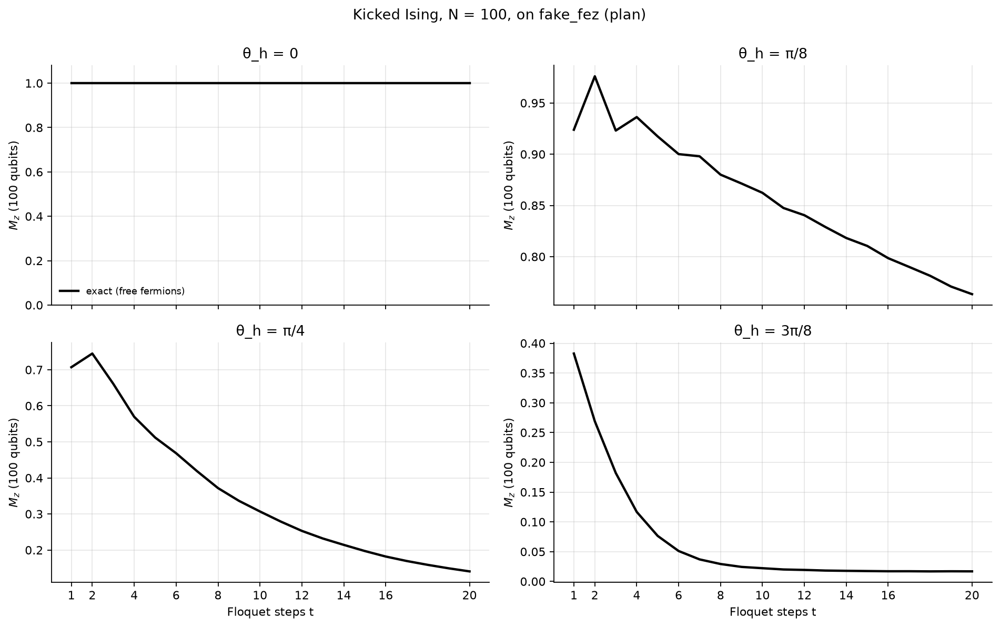

# [Team name] · Qiskit Fall Fest 2026 · Track 3: Quantum Simulation

| | |
|---|---|
| **Team** | [Team name] |
| **Members** | [Full name, email], [Full name, email], … (as registered) |
| **Track** | 3 · Quantum Simulation (*Dynamics Under Noise*) |
| **Level reached** | Advanced |
| **Code files** | [`track3_dynamics_under_noise.ipynb`](track3_dynamics_under_noise.ipynb) (main notebook) · [`ising_lab.py`](ising_lab.py) (helpers) · [`hardware/run_hardware.py`](hardware/run_hardware.py) (QPU submit/fetch) · [`scripts/intermediate_sim.py`](scripts/intermediate_sim.py) (noisy-simulator sweeps) |
| **Slides** | [`slides.pdf`](slides.pdf) (8 slides) |

## Summary

We simulate transverse-field and kicked Ising chains at three scales:
- **8 spins, noiseless.** We show that for Z-basis observables measured from |0…0⟩, Lie-Trotter and Suzuki-Trotter are *the same circuit*. So the cheapest "accurate enough" product formula depends on the observable.
- **12 spins, FakeFez noise.** We cut the circuit (2nd-order accuracy at 1st-order CZ cost, a zero-SWAP error-aware layout), recover the dynamics with our own TREX + zero-noise extrapolation code, and pick the Trotter step that minimises *total* error under noise.
- **100 qubits on an IBM Heron QPU.** We run a kicked (Floquet) Ising chain of up to 1881 CZ gates and certify every hardware number against **exact** answers that need no brute force: free-fermion Pfaffians at any depth, light-cone windows, and Clifford-point stabilisers.

## Approach

**Beginner (8 spins, J = h = 1, t ≤ 2).**
- *Reference:* exact evolution with `scipy.linalg.expm`.
- *Circuits:* `PauliEvolutionGate` with `LieTrotter` and `SuzukiTrotter(order=2)`, kept decomposed so the Trotter error stays visible.
- *Step-size scan:* a fast statevector engine, validated against the Qiskit circuits to 1e-14, scans 264 step sizes. For each formula and observable we find the largest Δt that keeps the error below 0.01 over the whole run, and the two-qubit gate cost of a full run.
- *Explanation:* we explain the observable dependence analytically (boundary half-steps) and confirm it numerically through the convergence orders: slope 2.00 vs 1.02.

**Intermediate (12 spins, FakeFez).**
- *Depth cutting:*
  - brickwork ZZ ordering, so two-qubit depth per step is constant in N;
  - merging adjacent Suzuki half-steps;
  - dropping the ZZ layer that acts trivially on |0…0⟩;
  - an error-aware qubit line, found by beam search over the coupling map and calibration data, so routing needs zero SWAPs.
- *Noise model:* a compact Pauli model built from FakeFez calibration (gate errors plus asymmetric readout), cross-checked against the full `AerSimulator.from_backend(FakeFez())` model.
- *Mitigation, implemented ourselves:*
  - TREX: readout bit-flip twirling plus calibration rescaling;
  - Pauli twirling, which we show is neutral on Pauli noise;
  - ZNE by CZ folding (λ = 1, 3, 5) with linear, exponential and Richardson extrapolation.
- *Step choice under noise:* a sweep of total error against Trotter step size.

**Advanced (kicked Ising, 100 qubits, IBM QPU).**
- *Circuits:* U = Π RX(θh) · Π RZZ(−π/2), with each RZZ compiled to one CZ. θh ∈ {0, π/8, π/4, 3π/8} and t ∈ {1…8, 10, 12, 14, 16, 20}. Seven Clifford circuits (θh = π/2) up to t = 20 come on top.
- *Layout:* a 100-qubit path chosen from that day's calibration.
- *Mitigation:* IBM Runtime EstimatorV2 with TREX, gate twirling, XpXm dynamical decoupling and gate-folding ZNE. A SamplerV2 job gives raw bitstrings and readout calibration.
- *Exact checks:* three methods, each scaling to N = 100, cross-validated to ~1e-14:
  1. **Free fermions.** A Jordan-Wigner Majorana covariance evolution, with a *ghost spin* that turns ⟨Zi⟩ into a Pfaffian. Any depth, 0.3 s at N = 100.
  2. **Light-cone windows.** A (2t+2)-qubit statevector gives all 100 sites exactly.
  3. **Clifford stabilisers.** At θh = π/2, ⟨U Zc U†⟩ = +1 exactly.

## Results

[Filled in from the notebook outputs: see the tables below.]

| Quantity | Our result | Reference | Difference |
|---|---|---|---|
| Largest Δt, error < 0.01, Mz (Lie = Suzuki) | 0.1667 (12 steps) | exact `expm` | max err 0.0098 |
| Largest Δt, error < 0.01, Mx, Lie / Suzuki | 0.0152 / 0.1818 | exact `expm` | 1848 vs 308 CX (Qiskit build) |
| Lie − Suzuki for Mz, ⟨Z0Z5⟩ | ≤ 7e-16 | identical by construction | — |
| 12-spin Mz, mean abs error, raw → TREX+ZNE (FakeFez) | [ ] → [ ] | exact | |
| 100-qubit Mz, θh = π/4, mitigated | [ ] | free-fermion exact | [ ] |
| Trust horizon (deepest t with \|mitigated − exact\| ≤ max(2σ, 0.05)) | [ ] | — | — |

## How we checked our results

- **Beginner:** against `scipy.linalg.expm` at every time step. The fast engine was checked against Qiskit `PauliEvolutionGate` circuits to 1e-14.
- **Intermediate:** noiseless Trotter circuit, exact dynamics, the compact noisy model, the full FakeFez noise model, and the real QPU (Job B), all compared on one plot.
- **Advanced:** free-fermion Pfaffians, light-cone windows and Clifford stabilisers. They are cross-validated against each other at N = 100 (~1e-14) and against full statevector at N = 12. Every hardware value is compared with the exact value. Two further checks need no exact answer: the agreement between exponential and linear ZNE, and the Clifford-point decay.

## Hardware runs

[Backend, job IDs and QPU seconds, from `results/hardware_jobs.json`.]

## Limitations

- **Classically easy by design.** Integrability is what makes the 100-qubit data certifiable, and it also makes this particular model easy for classical computers. With a longitudinal field, only light-cone (t ≲ 11), Clifford and consistency checks would remain.
- **ZNE by gate folding** multiplies depth by 3–5. At the deepest circuits the λ = 5 data approaches the noise floor. PEA or PEC would be next.
- **The simulator's Pauli noise model** cannot show the value of twirling or DD, which target coherent errors. On hardware those are applied by the Runtime primitives.
- **Limited shot budget** (Open Plan, 10 QPU minutes) means per-site error bars are larger than chain averages.

## How to run

- Python version: 3.12 (tested on Linux; Colab works too)
- Install: `pip install -r requirements.txt`
- Run: open `track3_dynamics_under_noise.ipynb` and *Run All* (about 5 minutes on a laptop). It loads the noisy-simulator sweeps and QPU results from `results/`.
  - `RECOMPUTE = True` re-runs the FakeFez sweeps, about 15 minutes (or run `python scripts/intermediate_sim.py`).
  - Hardware: `python hardware/run_hardware.py dry-run | submit | status | fetch` (needs a saved IBM Quantum account).

## Credits

- Track tutorial: adapted from the BasQ Qiskit Fall Fest 2026 tutorials by Benjamin Tirado (text CC BY 4.0, code Apache 2.0). Challenge prompt by Angel Rodriguez, Benjamin Tirado and Miguel Angel Jimenez, as adapted by Quantica, IIIT-Delhi.
- Papers: Kim *et al.*, Nature 618, 500 (2023); Childs *et al.*, PRX 11, 011020 (2021); van den Berg *et al.*, PRA 105, 032620 (2022) (TREX); Temme, Bravyi and Gambetta, PRL 119, 180509 (2017) (ZNE); Bertini, Kos and Prosen, PRL 123, 210601 (2019); Wimmer, ACM TOMS 38, 30 (2012) (Pfaffians).
- AI tools used: Claude (Anthropic) as a coding and writing assistant: drafting helper functions and notebook text, and debugging. All results were verified numerically in the notebook, and the team reviewed all analysis.
