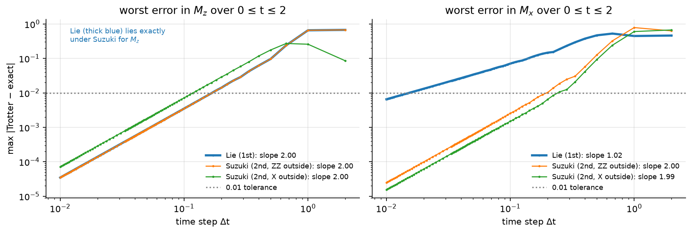
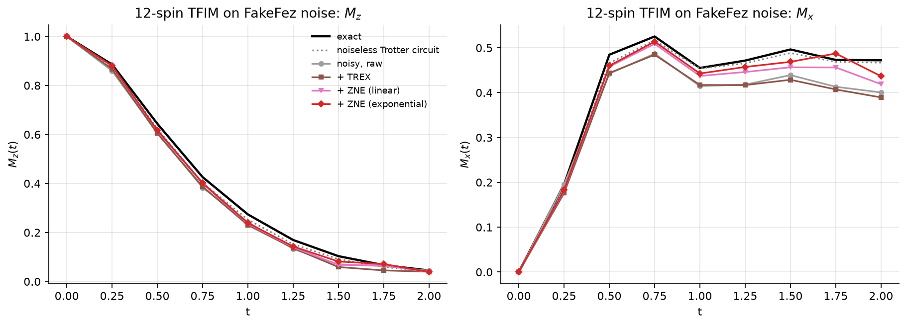
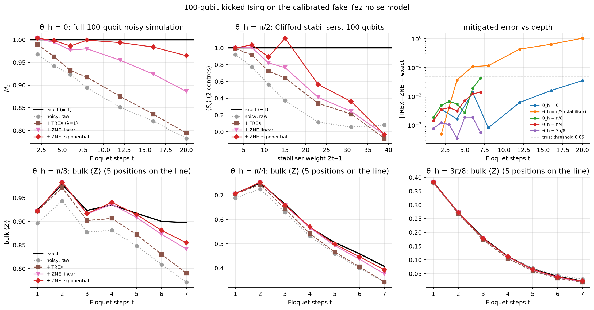

# GitBoosters · Qiskit Fall Fest 2026 · Track 3: Quantum Simulation

| | |
|---|---|
| **Team** | GitBoosters |
| **Members** | Pinaksh Kumar, pinakshkr@gmail.com · Keyur Desai, Keyurkumar25071@iiitd.ac.in |
| **Track** | 3 · Quantum Simulation (*Dynamics Under Noise*) |
| **Level reached** | **Intermediate** (complete), plus the **Advanced** analysis on a calibrated 100-qubit IBM Heron noise model. No real-QPU run: see [Hardware runs](#hardware-runs) |
| **Code files** | [`track3_dynamics_under_noise.ipynb`](track3_dynamics_under_noise.ipynb) (main notebook, runs top to bottom in ~5 min) · [`ising_lab.py`](ising_lab.py) (all helpers) · [`hardware/run_hardware.py`](hardware/run_hardware.py) (QPU dry-run / submit / fetch) · [`scripts/`](scripts/) (cached sweeps, notebook and slide builders) |
| **Slides** | [`slides.pdf`](slides.pdf) (8 slides) |

## Summary

We simulate transverse-field and kicked Ising chains at three scales.

- **8 spins.** For Z-basis observables measured from |0…0⟩, Lie-Trotter and Suzuki-Trotter are *the same circuit*. The cheapest "accurate enough" product formula therefore depends on what you measure. We prove this and confirm it numerically (convergence slopes 2.00 vs 1.02).
- **12 spins, FakeFez noise.** We cut the circuit first: 2nd-order accuracy at 1st-order CZ cost, and an error-aware layout with zero SWAPs. Our own TREX + zero-noise extrapolation code then recovers the dynamics, cutting the Mx error about 3×. We show that on noisy hardware a finer Trotter step stops helping: the error is noise-limited.
- **100 qubits.** We compile a kicked (Floquet) Ising chain of up to 1881 CZ gates onto a 100-qubit line of IBM's 156-qubit Heron r2 layout (FakeFez target, 0 SWAPs). We run it on a noise model built from that line's calibration, and mitigate it. Every number is certified against **exact** answers obtained without brute force: free-fermion Pfaffians at any depth, light-cone windows, and Clifford-point stabilisers.

## Approach

**Beginner (8 spins, J = h = 1, t ≤ 2)**
- *Reference:* exact evolution with `scipy.linalg.expm`.
- *Circuits:* `PauliEvolutionGate` with `LieTrotter` and `SuzukiTrotter(order=2)`, kept decomposed so the Trotter error stays visible.
- *Step-size scan:* a matrix engine, validated against the Qiskit circuits to 1e-14, scans 264 step sizes. For each formula and observable we find the largest Δt with error < 0.01 over the whole run, plus the CX cost.
- *Explanation:* we prove the observable dependence with a boundary argument. The first ZZ layer is a phase on |0…0⟩, and a final ZZ layer commutes with Z.

**Intermediate (12 spins, FakeFez = IBM Heron r2 snapshot)**
- *Depth cutting:*
  - brickwork ZZ ordering, so the two-qubit depth per step is constant in N;
  - merged Suzuki half-steps;
  - the trivial first layer dropped;
  - an error-aware line, from a beam search that minimises −log ESP using calibration data.
  Result: 176 CZ and two-qubit depth 32, against 322 / 322 for Qiskit's default `SuzukiTrotter`.
- *Noise model:* a compact Pauli model built from FakeFez calibration (gate errors plus asymmetric readout), cross-checked against the full `AerSimulator.from_backend(FakeFez())` model. Along the way we found that, in Aer 0.17.2, statevector simulation with shot branching silently drops readout errors. We documented this and worked around it.
- *Mitigation, implemented ourselves:*
  - TREX: readout bit-flip twirling plus calibration rescaling;
  - Pauli twirling, which we show is neutral on Pauli noise;
  - ZNE by CZ folding (λ = 1, 3, 5) with linear, exponential and Richardson extrapolation.
- *Step choice under noise:* a sweep of Trotter error against noise. The raw error hits a noise-limited plateau for Δt ≈ 0.25–0.4, and finer steps make it *worse* (0.105 at Δt = 0.167 vs 0.069 at 0.25). After ZNE, all Δt ≤ 0.4 agree within shot noise. So the Trotter-only choice Δt = 2/13 ≈ 0.15 (286 CZ) costs 62% more CZs than Δt = 0.25 (176 CZ) for no gain.

**Advanced (kicked Ising, 100 qubits)**
- *Circuits:* U = Π RX(θh) · Π RZZ(−π/2), with each RZZ compiled to one CZ and the trivial first layer dropped. θh ∈ {0, π/8, π/4, 3π/8} and t up to 20 (1881 CZ, two-qubit depth 38).
- *No routing:* the CZ count of every compiled circuit equals (t−1)·99, which proves the router added no SWAPs.
- *Exact references* that need no brute force, cross-validated to ~1e-14:
  1. Free fermions: Jordan-Wigner Majorana covariance evolution, with a **ghost spin** that turns ⟨Zi⟩ into a Pfaffian. Exact at any depth, 0.3 s at N = 100.
  2. Light-cone windows: one (2t+2)-qubit statevector gives all 100 sites.
  3. Clifford stabilisers: ⟨U Zc U†⟩ = +1.
- *Noisy 100-qubit runs:* at the Clifford points (θh = 0, π/2) the full noisy 100-qubit circuit is simulated exactly with a stabiliser simulator, including CZ-folded ZNE circuits. For non-Clifford angles, noisy (2t+1)-qubit light-cone windows at 5 positions along the line. Against full-chain density-matrix simulation they agree to ≤ 4×10⁻⁴, at most 4% of the (small) noise effect, and negligible next to the 0.05 trust threshold. The small mismatch comes from single-qubit compilation differences at the window edge.
- *Mitigation and trust:* TREX + ZNE. A trust horizon, plus internal consistency checks that need no exact answer.

## Results

| Quantity | Our result | Reference | Difference |
|---|---|---|---|
| Largest Δt with error < 0.01, Mz (Lie = Suzuki) | 0.1667 (12 steps) | exact `expm` | max err 0.0098 |
| Largest Δt with error < 0.01, Mx: Lie / Suzuki | 0.0152 / 0.1818 | exact `expm` | 1848 vs 308 CX (Qiskit build) |
| Lie − Suzuki for Mz and ⟨Z0Z5⟩ | ≤ 7e-16 | identical by construction | — |
| 12-spin circuit to t = 2: CZ / 2q depth / ESP | 176 / 32 / 0.50 | Qiskit default: 322 / 322 / 0.30 | −45% CZ, 10× lower 2q depth |
| 12-spin Mx, mean abs error vs noiseless circuit: raw → TREX + ZNE | 0.040 → 0.013 | noiseless Trotter circuit | ≈ 3× lower |
| 100-qubit θh = 0, t = 20 (1881 CZ): Mz raw → TREX + ZNE | 0.78 → **0.96** | exact 1 | 0.035 |
| 100-qubit Clifford stabilisers, TREX + ZNE: weight 7 / weight 39 | 0.96 / −0.03 | exact +1 | 0.037 (passes) / 1.03 (fails: signal below the noise floor) |
| 100-qubit bulk ⟨Z⟩, θh = π/8, π/4, 3π/8, t ≤ 7: max \|TREX+ZNE − exact\| | 0.043 | free-fermion exact | raw up to 0.13 |
| Trust horizon (\|ZNE − exact\| ≤ 0.05) on the 100-qubit emulator | θh = 0: t = 20 · non-Clifford angles: t = 7 (deepest emulated) · stabilisers: weight ≤ 7 | — | **horizon depends on observable weight** |

## How we checked our results

- **Beginner:** against `scipy.linalg.expm` at every time step. The matrix engine was checked against Qiskit `PauliEvolutionGate` circuits to 1e-14.
- **Intermediate:** exact dynamics, the noiseless Trotter circuit, the compact noise model and the full FakeFez noise model, all compared. The compact model agrees with the full model within 0.002–0.02 on the raw Mz.
- **Advanced:** three exact methods, cross-validated against each other at N = 100 (~1e-14) and against full statevector at N = 12. Each noisy and mitigated value is compared with its exact value. Two further checks need no exact answer: the agreement between exponential and linear ZNE, and the Clifford-point decay. We point out which agreements are *weak* evidence: when the exact answer is ≈ 0, noise "agrees" for free.

## Hardware runs

**None.** IBM Quantum account creation required a payment-card identity check that we could not complete before the deadline. Everything for a real-QPU run is prepared and validated against the FakeFez target:

- `python hardware/run_hardware.py submit` picks the least-busy Heron and finds the best 100-qubit line from live calibration. It then submits three Open Plan jobs (no sessions):
  - **A:** `EstimatorV2` with TREX, gate twirling, XpXm dynamical decoupling and gate-folding ZNE (52 kicked-Ising and 7 Clifford circuits).
  - **B:** the same options on the 12-spin TFIM circuits.
  - **C:** `SamplerV2` raw bitstrings plus readout calibration.
- The estimated cost is ~4 of the 10 free QPU minutes (an estimate, never measured). `submit --quick` runs a minimal Advanced subset (100-qubit circuits at t = 2–20, 2 Clifford checks) in ~1–2 minutes.
- The script refuses to run on any non-Open (paid) instance.
- `fetch` saves the results to `results/hardware_*.npz`, and the notebook's §2.5 and §3.4–3.7 then fill in automatically.

## Limitations

- **No real-QPU data.** The noise model has depolarising gate errors and readout errors, but no coherent errors, crosstalk, leakage or drift. Real hardware would decay faster and shorten the ZNE trust horizon. Twirling and DD, which target exactly those effects, are in the QPU plan.
- **Classically easy by design.** Integrability is what makes the 100-qubit results certifiable, and it also makes this particular model classically easy. With a longitudinal field, only light-cone (t ≲ 11), Clifford and consistency checks would remain.
- **ZNE by gate folding** multiplies depth by 3–5. At the deepest circuits the λ = 5 signal approaches the noise floor. The t = 20 residual (0.035, 3–5σ) is a systematic bias of the exponential fit, which the exponential-vs-linear spread flags. PEA or PEC would be next.
- **Emulator statistics:** Clifford-point runs use 400 shots per circuit. The light-cone windows average 200 noise trajectories and carry no measurement shot noise.

## How to run

- Python version: 3.12 (tested on Linux; Colab works too)
- Get the code: `git clone https://github.com/wireshark10/IBM-Qiskit-Hackathon && cd IBM-Qiskit-Hackathon`
- Install: `pip install -r requirements.txt`
- Run: open `track3_dynamics_under_noise.ipynb` and *Run All* (~5 minutes; cached sweeps load from `results/`).
  - Regenerate the caches: `python scripts/intermediate_sim.py` (~20 min) and `python scripts/emulate_advanced.py z0|stab|windows` (~25 min each).
  - Rebuild the slides: `python scripts/make_slides.py`.
  - QPU: `python hardware/run_hardware.py dry-run | submit | status | fetch`.

## Credits

- Track tutorial: adapted from the BasQ Qiskit Fall Fest 2026 tutorials by Benjamin Tirado (text CC BY 4.0, code Apache 2.0). Challenge prompt by Angel Rodriguez, Benjamin Tirado and Miguel Angel Jimenez, as adapted by Quantica, IIIT-Delhi.
- Papers:
  - Kim *et al.*, Nature 618, 500 (2023)
  - Childs *et al.*, PRX 11, 011020 (2021)
  - van den Berg *et al.*, PRA 105, 032620 (2022) (TREX)
  - Temme, Bravyi and Gambetta, PRL 119, 180509 (2017) (ZNE)
  - Bertini, Kos and Prosen, PRL 123, 210601 (2019)
  - Wimmer, ACM TOMS 38, 30 (2012) (Pfaffians)
- AI tools used: Claude (Anthropic) as a coding and writing assistant: drafting helper functions and notebook text, and debugging. All results were verified numerically in the notebook, and the team reviewed all analysis.
